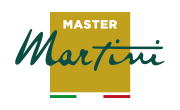

<div align="center">
  

  # Master Martini

  **Aplicación móvil educativa de recetas, técnicas y cursos de pastelería.**
</div>

## Descripción

Master Martini es una aplicación Android desarrollada como proyecto semestral. Su objetivo es ofrecer a emprendedores y profesionales gastronómicos un espacio donde puedan descubrir recetas, consultar técnicas y acceder a cursos relacionados con chocolatería, bollería y pastelería.

La aplicación utiliza contenido local y flujos simulados con fines demostrativos y académicos.

## Funcionalidades

- Registro e inicio de sesión.
- Persistencia local de la sesión del usuario.
- Pantalla de inicio con contenido recomendado.
- Búsqueda de recetas, videos y cursos.
- Filtros por tipo de contenido.
- Detalle de recetas con ingredientes y preparación.
- Detalle de cursos y listado de lecciones.
- Reproductor de video simulado.
- Formulario de contacto con validaciones.
- Perfil con datos personales y del negocio.
- Navegación inferior entre las secciones principales.

## Tecnologías utilizadas

- **Kotlin**
- **Jetpack Compose**
- **Material 3**
- **Android SDK 36**
- **Gradle con Kotlin DSL**
- **ViewModel** para el estado de los formularios
- **SharedPreferences** para la sesión local

## Estructura principal

```text
app/src/main/java/com/example/proyecto_semestral/
├── model/          # Modelos y catálogos de contenido
├── navigation/     # Navegación, sesión y usuarios
├── ui/
│   ├── components/ # Componentes reutilizables
│   ├── screens/    # Pantallas de la aplicación
│   └── theme/      # Colores, tipografías y formas
├── viewmodel/      # Estado y validación de formularios
└── MainActivity.kt # Punto de entrada de la aplicación
```

## Requisitos

- Android Studio
- JDK 21
- Android SDK 36
- Dispositivo o emulador con Android 7.0 (API 24) o superior

## Ejecución

1. Clona el repositorio:

   ```bash
   git clone <URL_DEL_REPOSITORIO>
   ```

2. Abre el proyecto en Android Studio.
3. Espera a que Gradle sincronice las dependencias.
4. Selecciona un emulador o dispositivo físico.
5. Ejecuta el módulo `app`.

También puedes comprobar la compilación desde una terminal de Windows:

```powershell
.\gradlew.bat :app:assembleDebug
```

## Consideraciones

- Las cuentas y los contenidos se utilizan como demostración local.
- El reproductor no consume videos externos; simula la experiencia de reproducción.
- El formulario de contacto valida los datos, pero no se conecta a un servicio empresarial.

## Proyecto académico

Desarrollado como parte del proyecto semestral de Desarrollo de Aplicaciones Móviles.
